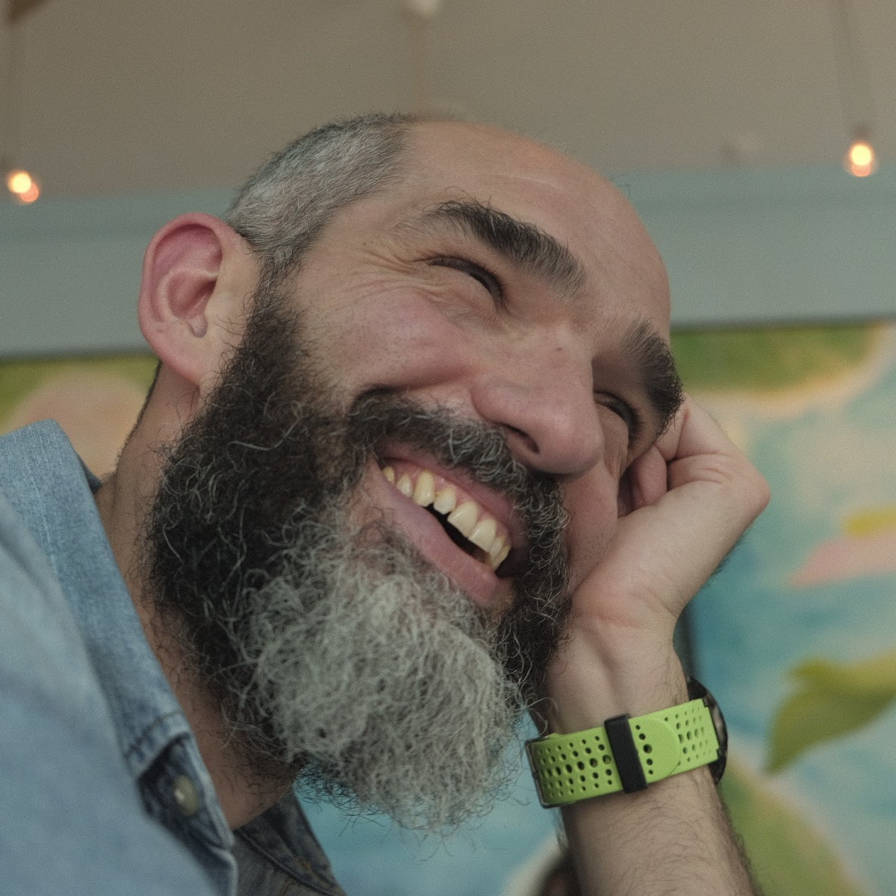
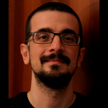
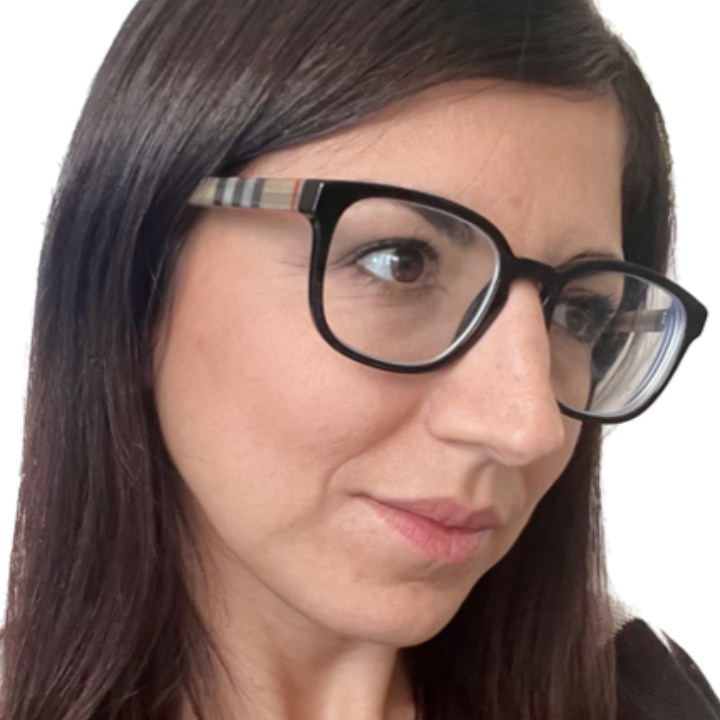
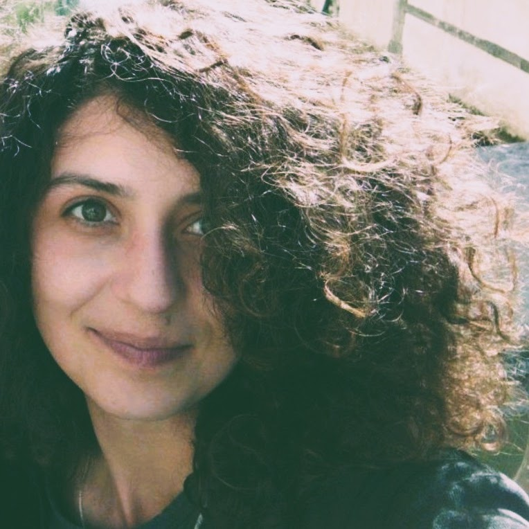
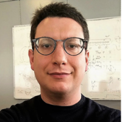
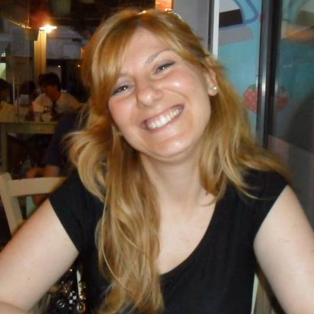
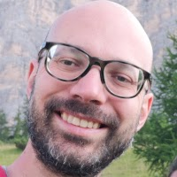

Below you can find the elected members of the ITRN Steering Committee for the 2025–2026 term.

::: {.people-grid .solo}
::: {.person .featured}
{fig-alt="Portrait of Davide Crepaldi"}

### Davide Crepaldi

[President-elect]{.role}
:::
:::

### Steering members

*In alphabetical order*

::: {.people-grid}
::: {.person}
{fig-alt="Portrait of Giorgio Arcara"}

### Giorgio Arcara
:::

::: {.person}
{fig-alt="Portrait of Manuela Berlingeri"}

### Manuela Berlingeri
:::

::: {.person}
{fig-alt="Portrait of Giulia Calignano"}

### Giulia Calignano
:::

::: {.person}
{fig-alt="Portrait of Vittorio Iacovella"}

### Vittorio Iacovella
:::

::: {.person}
{fig-alt="Portrait of Maria Montefinese"}

### Maria Montefinese
:::

::: {.person}
{fig-alt="Portrait of Michele Scandola"}

### Michele Scandola
:::
:::

::: {.callout-tip appearance="simple" icon="false"}
To all supporters who believe in open science and the importance of reproducibility; remember, even if you are not part of the Steering Committee, your contributions matter. Your ideas, passion, and active participation can help shape the future. Let's work together to make what we now call "open science" simply science!
:::
