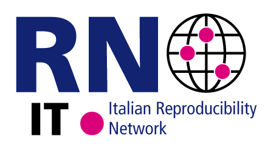

::: {.hero .column-screen}
::: {.hero-inner}
::: {.hero-logo}
{fig-alt="Italian Reproducibility Network logo"}
:::

::: {.hero-text}
[Italian Reproducibility Network]{.hero-title .h1 .d-block}

[A peer-led consortium promoting robust, transparent and reproducible research across the Italian scientific community.]{.hero-tagline .d-block}

[Join ITRN](join-itrn.qmd){.btn .btn-accent .btn-lg}
[Our initiatives](itrn-scientific-events/index.qmd){.btn .btn-outline-primary .btn-lg}
:::
:::
:::

::: {.callout-important appearance="simple" icon="false"}
## Save the date: ITRN Annual Meeting 2027 · Turin, 15–16 February 2027

The annual conference of ITRN will be hosted and organised by the National Institute of Metrological Research (INRiM) in Turin. Poster presentations in various categories and three awards. [Read the announcement →](news/posts/2026-09-18-save-the-date-turin-2027/index.qmd)
:::

::: {.callout-note appearance="simple" icon="false"}
## Steering Committee elections 2027–2028

Candidacies to [elections@itrn.org](mailto:elections@itrn.org) by **1 November 2026**. Online voting from **7 January** to **12 February 2027**. [Call for candidates and key dates →](news/posts/2026-10-02-steering-committee-elections-2027-2028/index.qmd)
:::

## The Italian Reproducibility Network

The Italian Reproducibility Network (ITRN) is a peer-led consortium that aims to investigate the factors that contribute to robust research and disseminate them within the Italian scientific community. This is achieved by [promoting initiatives](itrn-scientific-events/index.qmd) and acting as a [community](community/index.qmd) to get in touch, exchange ideas and good practices, and promote collective learning. ITRN seeks collaboration with scientists in several disciplines, technical experts in relevant fields and [stakeholders](https://www.ukrn.org/stakeholders/), so as to connect the widest possible spectrum of skills and knowledge.

Similarly to the other Reproducibility Networks in the world, ITRN investigates the factors that contribute to poor research reproducibility and replicability, and try to develop virtuous approaches to counter these factors and improve the quality of research. It also promotes collaboration among scientists and experts across a broad array of disciplines.

::: {.card-grid .four}
::: {.nav-card}
<i class="bi bi-people-fill" aria-hidden="true"></i>

### [Community](community/index.qmd){.stretched-link}

Steering Committee, local nodes, mailing list and newsletter.
:::

::: {.nav-card}
<i class="bi bi-lightbulb-fill" aria-hidden="true"></i>

### [Initiatives](itrn-scientific-events/index.qmd){.stretched-link}

Annual meeting, seminars, ReproCoffee, awards and teaching.
:::

::: {.nav-card}
<i class="bi bi-journal-bookmark-fill" aria-hidden="true"></i>

### [Resources](resources/index.qmd){.stretched-link}

Experts, recorded presentations and governance documents.
:::

::: {.nav-card}
<i class="bi bi-person-plus-fill" aria-hidden="true"></i>

### [Join ITRN](join-itrn.qmd){.stretched-link}

Become a member as a student, researcher, endorser or institution.
:::
:::

## Latest news

::: {#latest-news}
:::

[All news →](news/index.qmd)

## Events calendar

::: {.embed-responsive}
<iframe src="https://calendar.google.com/calendar/embed?height=600&wkst=1&ctz=Europe%2FRome&showPrint=0&src=aXRhbGlhbnJlcHJvZHVjaWJpbGl0eW5ldHdvcmtAZ21haWwuY29t&src=YzIxMzQyNTJhNTgyYzFlYWE3NjRkYmYxOThmMzE2NzgwMDg4YWVkNWRiMWU2NDNlNWZhYWFhYmZjOTRiZTRmM0Bncm91cC5jYWxlbmRhci5nb29nbGUuY29t&color=%23039be5&color=%23f6bf26" title="ITRN events calendar" loading="lazy"></iframe>
:::
