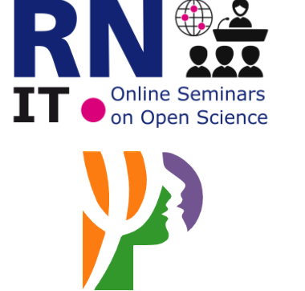

::: {.grid}
::: {.g-col-12 .g-col-md-8}
Online Seminars on Open Science is an ITRN initiative supported by the Italian Psychology Association ([Associazione Italiana di Psicologia, AIP](https://aipass.org/)), which provides the Zoom account for the virtual meetings.

The online seminars registration link will be available later on, usually a few days before each seminar. For additional information write to [educational@itrn.org](mailto:educational@itrn.org).

Seminars last 30/40 minutes plus 10/20 minutes for questions.
:::

::: {.g-col-12 .g-col-md-4}
{fig-alt="ITRN Online Seminars on Open Science and AIP logos" width="240px" fig-align="center"}
:::
:::

## Full playlists

- [2023/24 Edition – Full Playlist](https://www.youtube.com/watch?v=LXauIZPg_lE&list=PLWWeQrff40uAGZOt0GYsNre6yHWz-RngA)
- [2022/23 Edition – Full Playlist](https://www.youtube.com/watch?v=92n2Te6lltM&list=PLWWeQrff40uA9ZbT3ln6UUXLm7Mejml7e)
- [2021/22 Edition – Full Playlist](https://www.youtube.com/watch?v=raEbFvLA0UI&list=PLWWeQrff40uDGsOF2UxcuvzXJwTfZ3O6m)

## Editions

::: {.panel-tabset}
### 2024/25

Supported by [AIP – Associazione Italiana di Psicologia](https://aipass.org/).

| Date | Speaker | Title | Links |
|:-----|:--------|:------|:------|
| Wednesday 20 November 2024, 11 am CET | **Marcus Munafò**, Professor of biological psychology at the University of Bristol | Scientific Ecosystems and Research Reproducibility | [Video](https://youtu.be/4wAzL-tWD50) |
| Wednesday 11 December 2024, 3 pm CET | **Tony Ross-Hellauer**, Leader of the Open and Reproducible Research Group at Graz University of Technology | Large Language Models, Open Science and trust in scholarly work | [Video](https://youtu.be/YxeN_9XhcHs) · [Slides](https://docs.google.com/presentation/d/12yLeJjzTbGCgTttQ_MXweLseB72xzk6S/edit?usp=drive_link) |
| Wednesday 22 January 2025, 3 pm CET | **Julia Priess Bucheit**, Researcher at Kiel University | Open Science Practices and Intellectual Properties | [Video](https://youtu.be/dhyTi7x1swc) |
| Wednesday 12 February 2025, 3 pm CET | **Tibor Simko**, Computing Engineer CERN | Preserve-to-reuse: building open and reproducible data analysis services at CERN | *To be re-scheduled* |
| Wednesday 12 March 2025, 3 pm CET | **Uta Wehn**, Associate Professor of Water Innovation Studies at IHE Delft Institute for Water Education, The Netherlands | How to open science to society: Citizen Science | [Video](https://youtu.be/Lch_vRFxv5U) |
| Wednesday 9 April 2025, 3 pm CEST | **Lonni Besançon**, Assistant Professor of Visualization at Linköping University | Is Science Self-Correcting? A Tale of Obscurantism Slow Response and Misconduct | |
| Wednesday 14 May 2025, 3 pm CEST | **Jonny Coates**, Associate Director at ASAPBio | Preprints; putting the P in PRC | |
| Friday 27 June 2025, 2 pm CEST | **Tracey Weissgerber**, QUEST Center, Berlin Institute of Health at Charité | Data Visualization: How to Identify and Fix Common Problems | [Registration](https://us06web.zoom.us/meeting/register/zd9ib9fWRbK3RjC-CX9_5Q) |
| TBD | **Friederike E Kohrs**, Research Fellow at Charité BIH QUEST Center for Responsible Research | Strategies for making reproducible research and open science training the norm at research institutions | |

: {.striped .hover .table-sm}

### 2023/24

[Watch again all the videos](https://www.youtube.com/watch?v=LXauIZPg_lE&list=PLWWeQrff40uAGZOt0GYsNre6yHWz-RngA) · Supported by [AIP – Associazione Italiana di Psicologia](https://aipass.org/).

| Date | Speaker | Title | Links |
|:-----|:--------|:------|:------|
| Wednesday 29 November 2023, 3 pm CET | **Charlotte Pennington**, Lecturer at School of Psychology, Aston University, Birmingham, UK | A students' guide to open science | [Video](https://www.youtube.com/watch?v=LXauIZPg_lE) |
| Wednesday 6 December 2023, 3 pm CET | **Eiko Fried**, Associate Professor at Leiden University, Leiden, Netherlands | The Role of Measurement in the Open Science Reform | [Video](https://www.youtube.com/watch?v=DF1-Do1Cpqk) |
| Wednesday 17 January 2024, 3 pm CET | — | Hands-On on Preregistration | |
| Wednesday 7 February 2024, 3 pm CET | **Tom Heyman**, Assistant Professor at Leiden University, Leiden, Netherlands | Useful instruments for an open and collaborative research | [Video](https://www.youtube.com/watch?v=pOimKvTpt4A) |
| Wednesday 6 March 2024, 3 pm CET | **Alexandra Sarafoglou**, Postdoctoral researcher at University of Amsterdam | Combine Statistical Thinking With Open Scientific Practice: A Protocol of a Bayesian Research Project | [Video](https://www.youtube.com/watch?v=doe5yl3AvIc) |
| Wednesday 3 April 2024, 3 pm CET | **Rose Trappes**, University of Exeter | Philosophy of Open Science | [Video](https://www.youtube.com/watch?v=PATACw7-j2Q) |
| Wednesday 8 May 2024, 10 am CEST | **Wolf Vanpaemel**, University of Leuven | Increasing Transparency Through a Multiverse Analysis | [Video](https://youtu.be/GeDkUOgMuNg) · [Slides](https://bit.ly/ITRN-OSOS7-MultiverseAnalysis) |
| Wednesday 5 June 2024, 3 pm CEST | **Rita Morais**, Adviser for Research & Innovation at European University Association | Research assessment from an open science perspective | [Video](https://youtu.be/IDYJdmS7IgI) |

: {.striped .hover .table-sm}

### 2022/23

[Watch again all the videos](https://www.youtube.com/watch?v=92n2Te6lltM&list=PLWWeQrff40uA9ZbT3ln6UUXLm7Mejml7e) · Supported by [AIP – Associazione Italiana di Psicologia](https://aipass.org/).

| Date | Speaker | Title | Links |
|:-----|:--------|:------|:------|
| November 24, 2022, 3 PM | **Valentina Pasquale**, Italian Institute of Technology, IT | The transformative Potential of Open Science | [Video](https://www.youtube.com/watch?v=92n2Te6lltM) |
| December 14, 2022, 5 PM | **Nicholas Coles**, Stanford University, USA; Director of the Psychological Science Accelerator | Multi-lab and Multi-site Projects; the Psychological Science Accelerator | [Video](https://www.youtube.com/watch?v=10uKd9Bv27s) |
| January 11, 2023, 3 PM (CET) | **Rima-Maria Rahal**, Max Planck Institute for Research on Collective Goods, DE | Replication Studies | [Video](https://www.youtube.com/watch?v=OWx-Pu-ZtXI) |
| February 8, 2023, 3 PM (CET) | **Eric-Jan Wagenmakers**, University of Amsterdam, NL | Best Practices and Transparency in Statistics | [Video](https://www.youtube.com/watch?v=JCnKc9RHerc) |
| March 1, 2023, 3 PM (CET) | **Enrico Glerean**, Aalto University, School of Science, FI | Open issues in data sharing | [Video](https://www.youtube.com/watch?v=6oCzUAsuRw0) |
| April 5, 2023, 3 PM (CET) | **Iratxe Puebla**, Director of Strategic Initiatives & Community, ASAPbio | The Revision Process and Preprints | [Video](https://www.youtube.com/watch?v=V6kjIS07AlQ) |
| May 4, 2023, 11 AM (CEST) | **Alex Holcombe**, University of Sydney | Contributorship: Changing Practices to Better Credit Researchers | [Video](https://www.youtube.com/watch?v=lahRY5vP4DQ) |
| June 7, 2023, 3 PM (CEST) | **Ioana Cristea**, University of Padova, IT | Redesigning Incentives: Open Science Practices at the Cornerstone of Academic Evaluation | [Video](https://www.youtube.com/watch?v=HlWa07uHdPs) |

: {.striped .hover .table-sm}

### 2021/22

[Watch again all the videos](https://www.youtube.com/watch?v=raEbFvLA0UI&list=PLWWeQrff40uDGsOF2UxcuvzXJwTfZ3O6m) · Supported by [AIP – Associazione Italiana di Psicologia](https://aipass.org/).

| Date | Speaker | Title | Links |
|:-----|:--------|:------|:------|
| November 17, 2021 | **Brian Nosek**, University of Virginia and Executive Director of the Center for Open Science, US | Culture change toward more open, rigorous, and reproducible research | [Video](https://www.youtube.com/watch?v=raEbFvLA0UI) |
| December 15, 2021 | **Ernesto Carafoli**, Swiss Federal Institute of Technology, Zurich, Switzerland; Venetian Institute of Molecular Medicine, University of Padova, Italy | Fraud and self-correction in science | [Slides](https://drive.google.com/file/d/1wQG2EsTAk0ciqmhnyq9OgRCoqSYp2KOC/view?usp=sharing) · [Video](https://www.youtube.com/watch?v=gM0YK4-pM9g) |
| January 12, 2022 | **Chris Chambers**, Cardiff University, United Kingdom | New forms of publication and revision | [Video](https://www.youtube.com/watch?v=jld4olGa0gg) |
| February 9, 2022 | **Simine Vazire**, Melbourne University, Australia | Credibility beyond replicability | [Related material](https://psyarxiv.com/bu4d3) · [Video](https://www.youtube.com/watch?v=1xD4qGyInok) |
| March 9, 2022 | **Franca Agnoli**, University of Padova, Italy | The Prevalence of Questionable Research Practices and Scientific Misconduct | [Video](https://youtu.be/kmPJ_6y0Vh4) |
| April 6, 2022 | **Christina Bergmann**, Hochschule Osnabrück and Max Planck Institute for Psycholinguistics, Netherlands | Collaborating across time and space: How to get a large dataset together | [Slides](https://bit.ly/Bergman-ITRN-2022) · [Video](https://youtu.be/t1MLZ-St1uc) |
| May 5, 2022 | **Marco Perugini**, University of Milano-Bicocca, Italy | The signal and the noise: Sound research designs and power analysis | [Video](https://www.youtube.com/watch?v=Y3WixsmLlVc) |
| June 1, 2022 | **Felix Schönbrodt**, Ludwig-Maximilians-Universität München, Germany | Open Science, metrics, and career | [Slides](https://osf.io/ygaju/) · [Video](https://youtu.be/wHADv7nPRBI) |

: {.striped .hover .table-sm}
:::

We thank the Italian Psychology Association (Associazione Italiana di Psicologia, AIP) for providing the Zoom account for the Online Seminars on Open Science.
