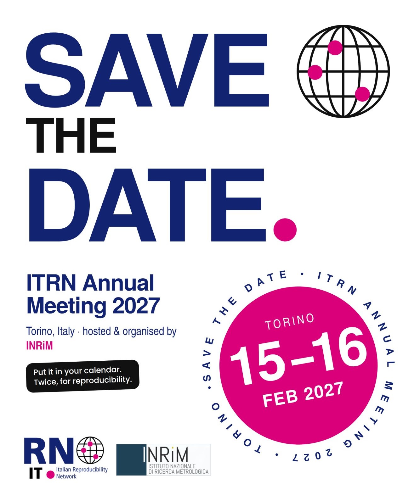

{fig-alt="Save the date flyer: ITRN Annual Meeting 2027, Torino, 15–16 February 2027, hosted and organised by INRiM" width="70%" fig-align="center"}

Dear all,

We are delighted to announce that the annual conference of the Italian Reproducibility Network (ITRN) will be held in Turin!

On **15 and 16 February 2027**, the Italian reproducibility community will gather at the **National Institute of Metrological Research (INRiM)**, which will host and organise the event. The local organizer committee is coordinated by Michaela Kuepferling.

These two days will be dedicated to reproducibility, open science and the promotion of increasingly robust, high-quality research.

You'll be able to present scientific posters across various categories, and you can enter the competition for one of three awards!

🚀 Mark the date in your calendar — twice, for #reproducibility!

The programme and registration details will be available shortly on the website [www.itrn.org](https://www.itrn.org/).

## Share it on your social

- [Facebook](https://www.facebook.com/permalink.php?story_fbid=pfbid0JidyL7JGcYs6XN54FNwhhgHmfEXB67wDT5Ci7KHVv7rkZLQejMW5mhgCBeMjGCWsl&id=61588036597299)
- [LinkedIn](https://www.linkedin.com/posts/italian-reproducibility-network_torino-itrn2027-itrn-activity-7506715041325576192-312k)
- [Instagram](https://www.instagram.com/p/DdbaozwAOFC/)

## Download the flyers

- [Blue version](https://drive.google.com/file/d/1VZU56gNZaptDTjpZ1NffLsGvPjSPB0uN/view?usp=drive_link)
- [White version](https://drive.google.com/file/d/1nmTno7UrteM8DCu2WbVcGNmu9KqwU6Bk/view?usp=drive_link)

See you soon in Turin!
